# Intro-to-VLSI

A bottom-up VLSI and computer architecture project using **VHDL and AMD Xilinx Vivado**. This repository documents the journey from fundamental logic gates to combinational circuits, sequential logic, registers, and a custom 8-bit accumulator CPU.

The project follows a **bottom-up design methodology**: each digital component is designed, simulated, and verified before being used to build a larger circuit.

## Table of Contents

1. [Design Environment](#-design-environment)
2. [Logic Gates](#-logic-gates)
3. [Combinational Arithmetic](#-combinational-arithmetic)
4. [Sequential Logic and Storage](#-sequential-logic-and-storage)
5. [Current Design Hierarchy](#-current-bottom-up-design-hierarchy)
6. [Final Project: Set 4 CPU](#-final-project-set-4--8-bit-accumulator-cpu)
7. [Design and Verification Flow](#-design-and-verification-flow)
8. [Repository Structure](#-repository-structure)
9. [Project Goal](#-project-goal)

---

## 🛠️ Design Environment

- **Hardware Description Language:** VHDL
- **Development Suite:** AMD Xilinx Vivado
- **Simulation Tool:** Vivado Simulator (XSIM)
- **Design Methodology:** Bottom-Up Structural Design
- **Project Type:** Digital Logic Design and Computer Architecture

---

# 🔹 Logic Gates

The project starts with the NAND gate as a universal logic gate. Other basic logic gates are constructed using NAND-based logic.

## Milestone 1: Primitive NAND Gate

**Status:** Completed and Verified

The NAND gate produces LOW only when both inputs are HIGH.

| A | B | Y = A NAND B |
|---|---|---|
| 0 | 0 | 1 |
| 0 | 1 | 1 |
| 1 | 0 | 1 |
| 1 | 1 | 0 |

**Simulation**

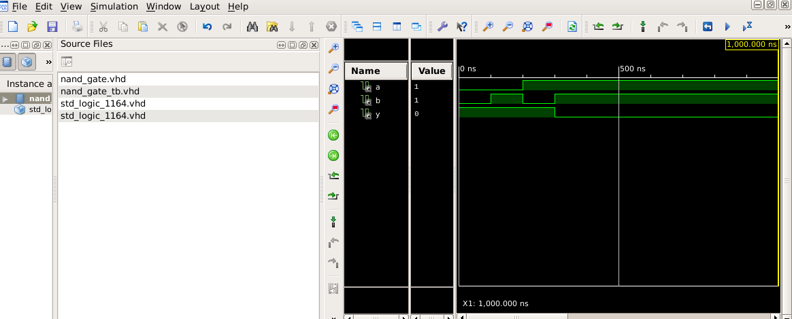

## Milestone 2: NOT Gate

**Status:** Completed and Verified

The NOT gate is constructed using the previously designed NAND gate.

| A | Y |
|---|---|
| 0 | 1 |
| 1 | 0 |

**Simulation**

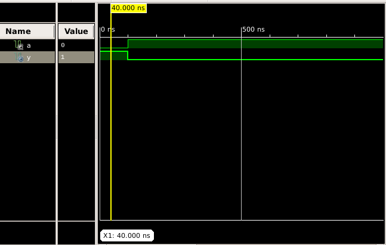

## Milestone 3: AND Gate

**Status:** Completed and Verified

The AND gate is structurally constructed using NAND gates.

| A | B | Y = A AND B |
|---|---|---|
| 0 | 0 | 0 |
| 0 | 1 | 0 |
| 1 | 0 | 0 |
| 1 | 1 | 1 |

**Simulation**

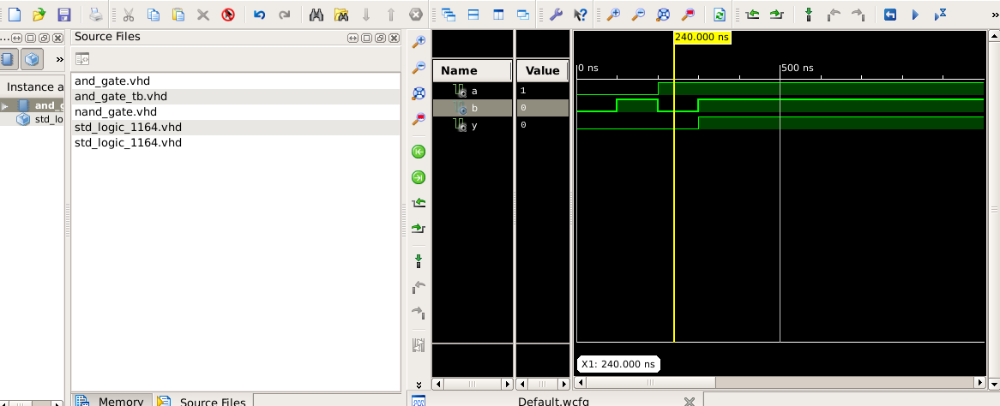

## Milestone 4: OR Gate

**Status:** Completed and Verified

The OR gate produces HIGH when at least one input is HIGH.

| A | B | Y = A OR B |
|---|---|---|
| 0 | 0 | 0 |
| 0 | 1 | 1 |
| 1 | 0 | 1 |
| 1 | 1 | 1 |

**Simulation**

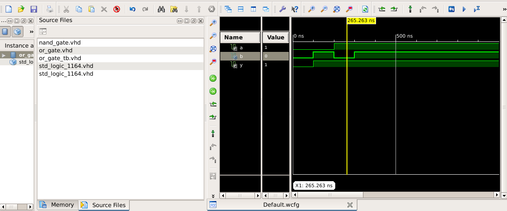

## Milestone 5: XOR Gate

**Status:** Completed and Verified

The XOR gate produces HIGH when the two input bits are different.

| A | B | Y = A XOR B |
|---|---|---|
| 0 | 0 | 0 |
| 0 | 1 | 1 |
| 1 | 0 | 1 |
| 1 | 1 | 0 |

**Simulation**

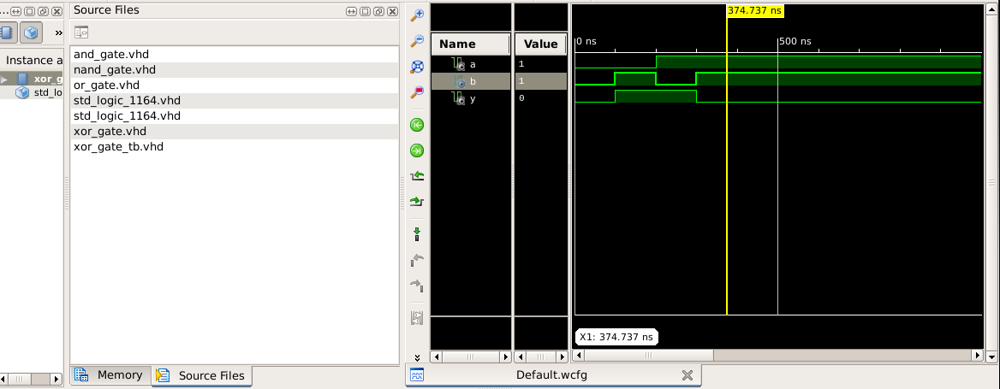

---

# ➕ Combinational Arithmetic

## Milestone 6: 1-Bit Full Adder

**Status:** Completed and Verified

The 1-bit full adder takes two input bits and a carry input. It produces a SUM bit and a carry output.

| A | B | Cin | SUM | Cout |
|---|---|---|---|---|
| 0 | 0 | 0 | 0 | 0 |
| 0 | 0 | 1 | 1 | 0 |
| 0 | 1 | 0 | 1 | 0 |
| 0 | 1 | 1 | 0 | 1 |
| 1 | 0 | 0 | 1 | 0 |
| 1 | 0 | 1 | 0 | 1 |
| 1 | 1 | 0 | 0 | 1 |
| 1 | 1 | 1 | 1 | 1 |

**Simulation**

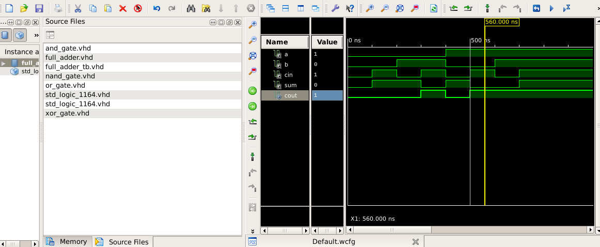

## Milestone 7: 8-Bit Adder

**Status:** Completed and Verified

The 8-bit adder is constructed by cascading eight 1-bit full adders in a ripple-carry configuration.

### Example Test Cases

| A | B | Cin | SUM | Cout |
|---|---|---|---|---|
| 00000000 | 00000000 | 0 | 00000000 | 0 |
| 00000001 | 00000001 | 0 | 00000010 | 0 |
| 00000101 | 00000011 | 0 | 00001000 | 0 |
| 00001111 | 00000001 | 0 | 00010000 | 0 |
| 11111111 | 00000001 | 0 | 00000000 | 1 |
| 10101010 | 01010101 | 0 | 11111111 | 0 |
| 11110000 | 00001111 | 0 | 11111111 | 0 |
| 11111111 | 11111111 | 0 | 11111110 | 1 |

**Simulation**

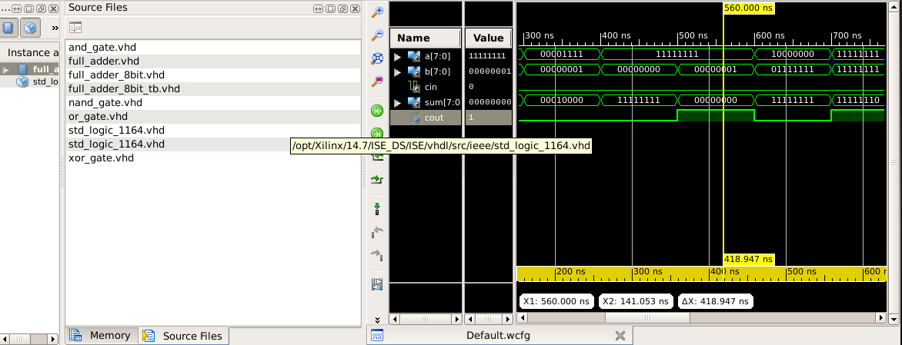

---

# 🔄 Sequential Logic and Storage

Sequential circuits introduce memory and allow digital systems to retain information over time.

## Milestone 8: SR Latch

**Status:** Completed and Verified

The SR latch is constructed using two cross-coupled NAND gates. Its S and R inputs are active-low.

| S | R | Q (Next) | Operation |
|---|---|---|---|
| 1 | 1 | Q | Hold |
| 0 | 1 | 1 | Set |
| 1 | 0 | 0 | Reset |
| 0 | 0 | Invalid | Invalid |

**Simulation**

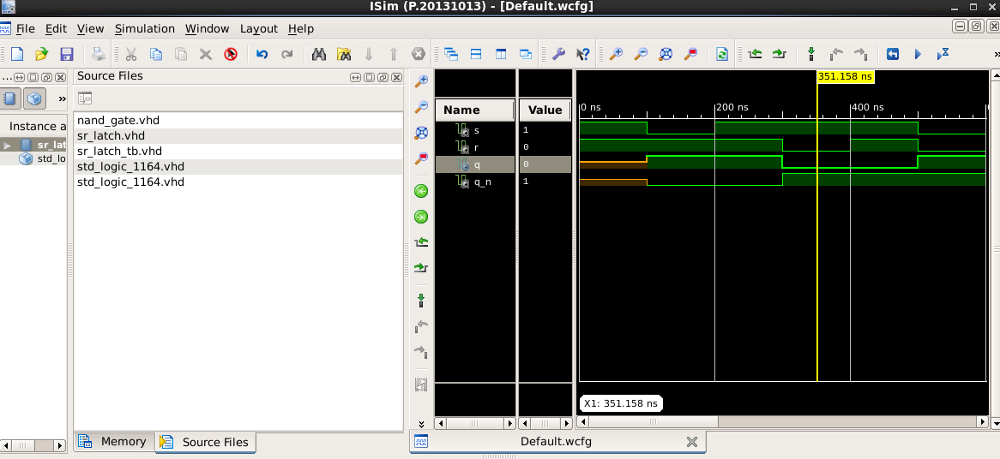

## Milestone 9: D Latch

**Status:** Completed and Verified

The D latch is constructed using the NOT gate, NAND gates, and SR latch.

| ENABLE | D | Q (Next) | Operation |
|---|---|---|---|
| 0 | 0 | Q | Hold |
| 0 | 1 | Q | Hold |
| 1 | 0 | 0 | Store 0 |
| 1 | 1 | 1 | Store 1 |

When `ENABLE = 1`, the latch follows the D input. When `ENABLE = 0`, it holds the previous value.

**Simulation**

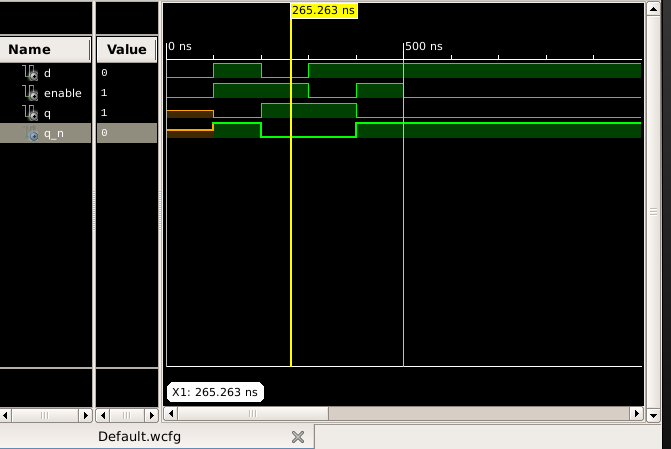

## Milestone 10: SR Flip-Flop

**Status:** Completed and Verified

The SR flip-flop provides clock-controlled storage based on Set and Reset inputs.

| CLK | S | R | Q (Next) | Operation |
|---|---|---|---|---|
| 0 | X | X | Q | Hold |
| 1 | 0 | 0 | Q | Hold |
| 1 | 0 | 1 | 0 | Reset |
| 1 | 1 | 0 | 1 | Set |
| 1 | 1 | 1 | Invalid | Invalid |

`X` represents a don't-care input in the inactive-clock condition.

**Simulation**

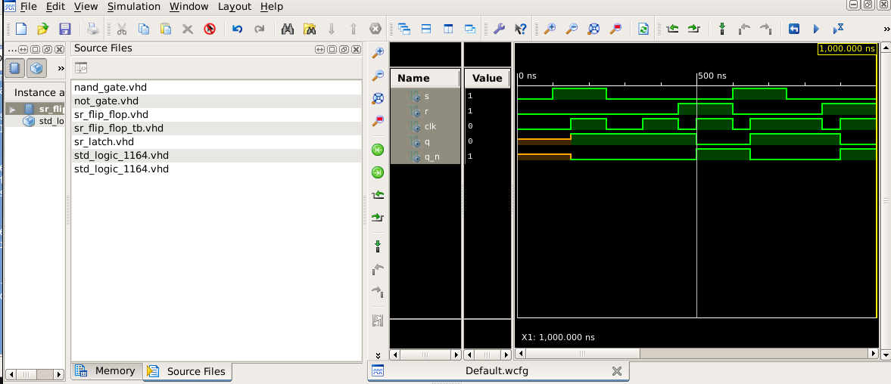

## Milestone 11: D Flip-Flop

**Status:** Completed and Verified

The D flip-flop captures its input at the active clock transition and retains the stored value between active transitions.

| Clock Event | D | Q (Next) | Operation |
|---|---|---|---|
| No active transition | 0 | Q | Hold |
| No active transition | 1 | Q | Hold |
| Active transition | 0 | 0 | Store 0 |
| Active transition | 1 | 1 | Store 1 |

**Simulation**

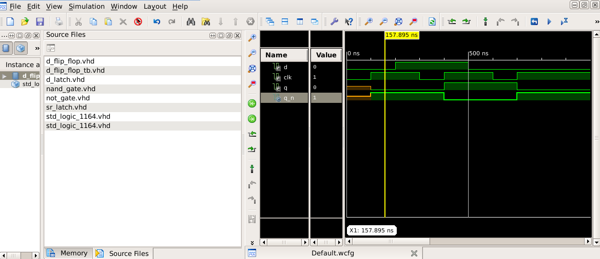

## Milestone 12: D Master-Slave Flip-Flop

**Status:** Completed and Verified

The master-slave flip-flop is constructed using two D latches.

- **Master:** Enabled when `CLK = 0`.
- **Slave:** Enabled when `CLK = 1`.
- The master captures the input while the clock is LOW.
- The slave transfers the stored value to the output while the clock is HIGH.

### Structure

```text
             +------------------+
D ---------->|   Master D Latch |
             |   ENABLE = CLK'  |
             +--------+---------+
                      |
                      v
             +------------------+
CLK -------->|    Slave D Latch |
             |    ENABLE = CLK  |
             +--------+---------+
                      |
                      v
                      Q
```

**Simulation**

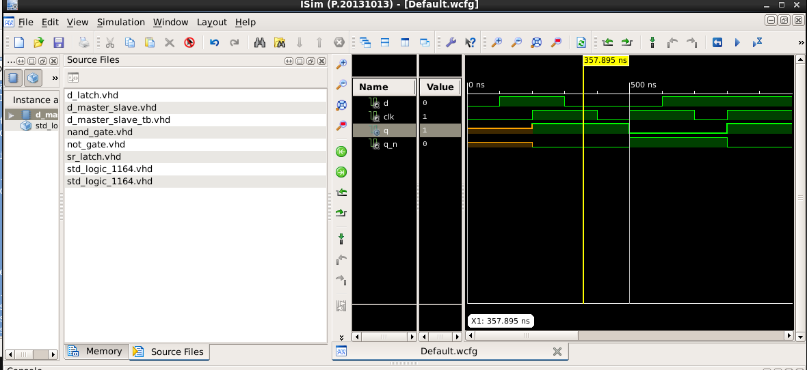

## Milestone 13: 1-Bit Register

**Status:** Completed and Verified

A 1-bit register stores one bit of data using a D master-slave flip-flop.

| D | Clock Event | Q (Next) | Operation |
|---|---|---|---|
| 0 | No active transition | Q | Hold |
| 1 | No active transition | Q | Hold |
| 0 | Active transition | 0 | Store 0 |
| 1 | Active transition | 1 | Store 1 |

**Simulation**

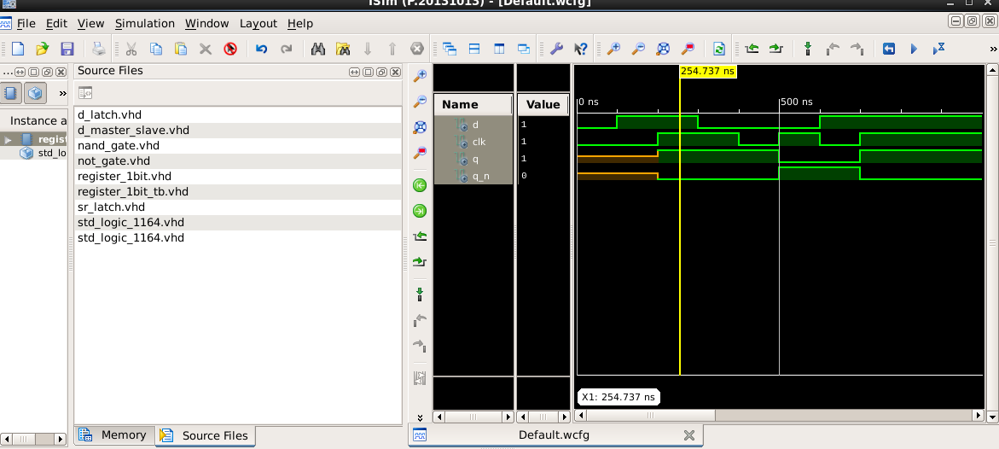

## Milestone 14: 4-Bit Register

**Status:** Structural Design

A 4-bit register can be constructed by connecting four 1-bit registers to a common clock.

| D[3:0] | Clock Event | Q[3:0] (Next) |
|---|---|---|
| 0000 | Active transition | 0000 |
| 0101 | Active transition | 0101 |
| 1010 | Active transition | 1010 |
| 1111 | Active transition | 1111 |

## Milestone 15: 8-Bit Register

**Status:** Completed and Verified

The 8-bit register is constructed using eight 1-bit registers sharing a common clock. It stores a complete 8-bit data word.

| D[7:0] | Clock Event | Q[7:0] (Next) |
|---|---|---|
| 00000000 | Active transition | 00000000 |
| 10101010 | Active transition | 10101010 |
| 11001100 | Active transition | 11001100 |
| 11110000 | Active transition | 11110000 |
| 01010101 | Active transition | 01010101 |

**Simulation**

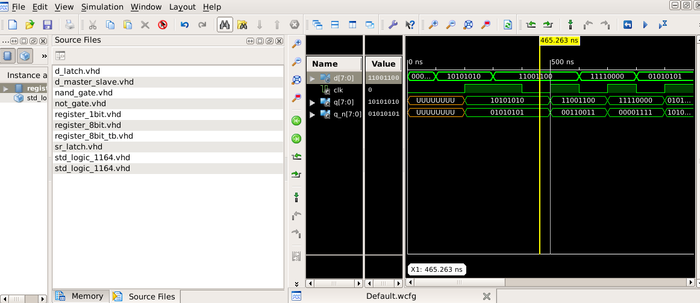

---

# 🧩 Current Bottom-Up Design Hierarchy

The following diagram summarizes the main development path from logic gates to storage elements and arithmetic circuits.

```text
             NAND Gate
                 |
       +---------+---------+
       |         |         |
    NOT Gate  AND Gate  OR Gate
                           |
                        XOR Gate
                           |
                           v
                    1-Bit Full Adder
                           |
                           v
                      8-Bit Adder


             NAND Gates
                 |
                 v
              SR Latch
                 |
                 v
              D Latch
                 |
                 v
           D Flip-Flop
                 |
                 v
        D Master-Slave FF
                 |
                 v
           1-Bit Register
                 |
          +------+------+
          |             |
          v             v
     4-Bit Register  8-Bit Register
```

These are related development paths; the complete CPU uses its own modular architecture described in the final project section below.

---

# 🚀 Final Project: Set 4 — 8-Bit Accumulator CPU

The final project integrates concepts from digital logic, arithmetic circuits, sequential logic, and registers to implement a small accumulator-based CPU using VHDL.

**Project:** Mini 8-Bit Accumulator CPU Design Using VHDL

**Course:** CSE 450 — VLSI Lab

**Assignment:** Set 4

**Development Environment:** AMD Xilinx Vivado

**Simulation:** Vivado Simulator (XSIM)

**Architecture:** Modular, single-cycle CPU

**Instruction Width:** 12 bits

**Accumulator Width:** 8 bits

**Supported Instructions:** LDI, ADD, STA, LDR, AND

**[Open the Final Project folder](https://github.com/MD-Yeamin-Bhuiyan/Intro-to-VLSI/tree/main/Final_Project)**

## Project Objectives

- Design a small CPU using separate VHDL modules.
- Implement the Program Counter, Program ROM, Control Unit, ALU, and registers.
- Execute the five instructions required for Set 4.
- Use a synchronous, active-high reset.
- Verify instruction execution with a CPU testbench.
- Observe the accumulator, stored register, zero flag, and Program Counter during simulation.

## CPU Architecture

The CPU is organized into separate modules that communicate through instruction, data, and control signals.

```text
                 +------------------+
                 | Program Counter  |
                 |    PC[3:0]       |
                 +--------+---------+
                          |
                          v
                 +------------------+
                 |   Program ROM    |
                 | 12-bit instruction|
                 +--------+---------+
                          |
                          v
                 +------------------+
                 |   Control Unit   |
                 | Opcode Decoding  |
                 +--------+---------+
                          |
                          v
                 +------------------+
                 |       ALU        |
                 |    ADD / AND     |
                 +--------+---------+
                          |
                          v
                 +------------------+
                 |   ACC / R / Z    |
                 |   CPU Registers  |
                 +------------------+
```

All state updates are synchronized with the rising edge of the clock. The active-high reset initializes the CPU state.

The design uses a modular single-cycle execution approach; it is not a multi-stage pipelined processor.

## CPU Modules

| Module | Responsibility |
|---|---|
| `pc.vhd` | Holds the program address and advances to the next instruction. |
| `program_rom.vhd` | Stores the Set 4 instruction sequence and supplies instructions using the PC address. |
| `control_unit.vhd` | Decodes the opcode and produces the control signals required for execution. |
| `alu.vhd` | Performs arithmetic and logical operations, including ADD and AND. |
| `registers.vhd` | Implements the accumulator (ACC), R register, and zero flag (Z). |
| `cpu_top.vhd` | Connects the modules to form the complete CPU. |
| `tb_cpu.vhd` | Generates the clock and reset, runs the CPU, and checks expected results. |

## Instruction Set

The CPU supports the following five instructions.

| Instruction | Operation | Description |
|---|---|---|
| `LDI` | `ACC = immediate` | Loads an immediate value into the accumulator. |
| `ADD` | `ACC = ACC + operand` | Adds the operand to the accumulator. |
| `STA` | `R = ACC` | Stores the accumulator value in R. |
| `LDR` | `ACC = R` | Loads the stored value from R into the accumulator. |
| `AND` | `ACC = ACC AND operand` | Performs bitwise AND between the accumulator and operand. |

## Instruction Execution Program

The ROM program executes ten instructions.

| PC | Instruction | Expected ACC (Hex) | Expected R (Hex) | Z |
|---|---|---:|---:|---:|
| 0 | `LDI 1E` | 1E | 00 | 0 |
| 1 | `STA` | 1E | 1E | 0 |
| 2 | `ADD 22` | 40 | 1E | 0 |
| 3 | `AND 60` | 40 | 1E | 0 |
| 4 | `LDR` | 1E | 1E | 0 |
| 5 | `ADD 01` | 1F | 1E | 0 |
| 6 | `AND 0F` | 0F | 1E | 0 |
| 7 | `STA` | 0F | 0F | 0 |
| 8 | `LDI 00` | 00 | 0F | 1 |
| 9 | `LDR` | 0F | 0F | 0 |

The table shows the register values after each instruction has executed.

## Example of Instruction Execution

### 1. Load Immediate — LDI

`LDI 1E` loads hexadecimal `1E` into the accumulator.

```text
ACC = 1E
```

### 2. Store Accumulator — STA

`STA` copies the accumulator value into R.

```text
ACC = 1E
R   = 1E
```

### 3. Add — ADD

`ADD 22` adds hexadecimal `22` to the accumulator.

```text
  1E
+ 22
----
  40

ACC = 40
```

### 4. Bitwise AND — AND

`AND 60` performs a bitwise AND operation.

```text
ACC = 40 = 0100 0000
     60 = 0110 0000
          ---------
     AND = 0100 0000

ACC = 40
```

### 5. Load Register — LDR

`LDR` restores the previously stored value from R to the accumulator.

```text
ACC = R = 1E
```

The remaining instructions continue the program, ultimately storing `0F` in R and loading it back into the accumulator.

## Testbench and Verification

The main testbench, `tb_cpu.vhd`, verifies the complete CPU.

It performs the following tasks:

1. Generates a 20 ns clock.
2. Applies the synchronous, active-high reset for one rising clock edge.
3. Releases reset and allows the ROM program to execute.
4. Checks the expected accumulator, R register, zero flag, and PC after each instruction.
5. Reports assertion errors if an expected value does not match.

The testbench checks the instruction sequence through the complete CPU instead of testing only an isolated ALU or register.

## Expected Final Output

After the final instruction, `LDR` at PC address 9, the expected output values are:

| Signal | Expected value | Meaning |
|---|---|---|
| `Q[7:0]` | `0F` | Accumulator contains hexadecimal 0F. |
| `R_DBG[7:0]` | `0F` | R register contains hexadecimal 0F. |
| `Z` | `0` | Accumulator is not zero. |
| `PC[3:0]` | `A` | PC points to address A, following the last executed instruction. |

**Simulation Waveform**

Place the actual CPU simulation screenshot in the following location, and update the path if your filename differs.

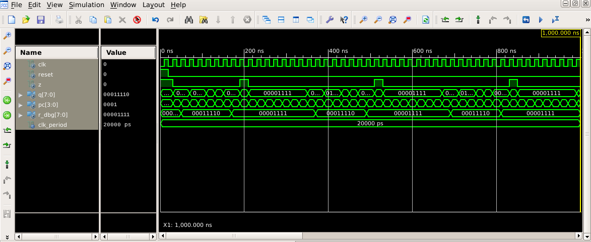

The waveform should show `CLK`, `RESET`, `PC`, `Q`, `Z`, and `R_DBG` during execution.

## Final Project Folder Structure

```text
Final_Project/
│
├── Source/
│   ├── pc.vhd
│   ├── program_rom.vhd
│   ├── control_unit.vhd
│   ├── alu.vhd
│   ├── registers.vhd
│   └── cpu_top.vhd
│
├── Testbench/
│   └── tb_cpu.vhd
│
├── Output_images/
│   ├── cpu_simulation_waveform.png
│   
│
└── README.md
```

This is the recommended organization. Keep your existing filenames and folder names if they differ, and update the documentation accordingly.

## Final Project Result

The Set 4 project brings together the main concepts learned throughout the repository: combinational logic, arithmetic operations, sequential state, register storage, instruction decoding, and modular design.

The complete CPU is intended to execute five instructions and demonstrate their behavior through simulation. The final result should be confirmed by the actual Vivado waveform and successful testbench assertions.

---

# 🔬 Design and Verification Flow

Each circuit follows a structured development process:

```text
Design the Circuit
       |
       v
Write VHDL RTL
       |
       v
Create Testbench
       |
       v
Run Simulation
       |
       v
Check Expected Output
       |
       v
Capture Waveform
       |
       v
Integrate into Larger Circuit
```

This process helps detect errors in individual modules before integration.

---

# 📁 Repository Structure

The repository contains the original VLSI building blocks and the final CPU project.

```text
Intro-to-VLSI/
│
├── rtl/
│   ├── nand_gate.vhd
│   ├── not_gate.vhd
│   ├── and_gate.vhd
│   ├── or_gate.vhd
│   ├── xor_gate.vhd
│   ├── full_adder.vhd
│   ├── full_adder_8bit.vhd
│   ├── sr_latch.vhd
│   ├── d_latch.vhd
│   ├── sr_flip_flop.vhd
│   ├── d_flip_flop.vhd
│   ├── d_master_slave.vhd
│   ├── register_1bit.vhd
│   └── register_8bit.vhd
│
├── testbench/
│   ├── nand_gate_tb.vhd
│   ├── not_gate_tb.vhd
│   ├── and_gate_tb.vhd
│   ├── or_gate_tb.vhd
│   ├── xor_gate_tb.vhd
│   ├── full_adder_tb.vhd
│   ├── full_adder_8bit_tb.vhd
│   ├── sr_latch_tb.vhd
│   ├── d_latch_tb.vhd
│   ├── sr_flip_flop_tb.vhd
│   ├── d_flip_flop_tb.vhd
│   ├── d_master_slave_tb.vhd
│   ├── register_1bit_tb.vhd
│   └── register_8bit_tb.vhd
│
├── Output_images/
│   ├── nand_gate/
│   ├── not_gate/
│   ├── and_gate/
│   ├── or_gate/
│   ├── xor_gate/
│   ├── full_adder/
│   ├── full_adder_8bit/
│   ├── sr_latch/
│   ├── d_latch/
│   ├── sr_flip_flop/
│   ├── d_flip_flop/
│   ├── d_master_slave/
│   ├── register_1bit/
│   └── register_8bits/
│
├── Final_Project/
│   ├── Source/
│   ├── Testbench/
│   ├── Output_images/
│   └── README.md
│
└── README.md
```

*The tree illustrates the intended organization. Adjust it to reflect the files actually present in your repository.*

---

# 🎯 Project Goal

The goal of this repository is to develop a practical understanding of digital system design and computer architecture using VHDL.

The learning path progresses from individual digital components to a complete processor:

```text
Logic Gates
    |
    v
Combinational Circuits
    |
    v
Arithmetic Units
    |
    v
Latches and Flip-Flops
    |
    v
Registers
    |
    v
CPU Datapath and ALU
    |
    v
Control Unit and Program Counter
    |
    v
Instruction Memory
    |
    v
Modular 8-Bit Accumulator CPU
```

Each stage builds on concepts introduced in earlier stages. The final CPU project demonstrates how individual digital components can be integrated into a working processor design.

---

## 👨‍💻 Author

**Md. Yeamin Bhuiyan**

B.Sc. in Computer Science and Engineering

University of Asia Pacific (UAP)

**Repository:** [Intro-to-VLSI on GitHub](https://github.com/MD-Yeamin-Bhuiyan/Intro-to-VLSI)

**Final Project:** [Set 4 — 8-Bit Accumulator CPU](https://github.com/MD-Yeamin-Bhuiyan/Intro-to-VLSI/tree/main/Final_Project)

---

*This repository is an ongoing learning project. New modules, testbenches, simulation results, and documentation can be added as the design evolves.*
